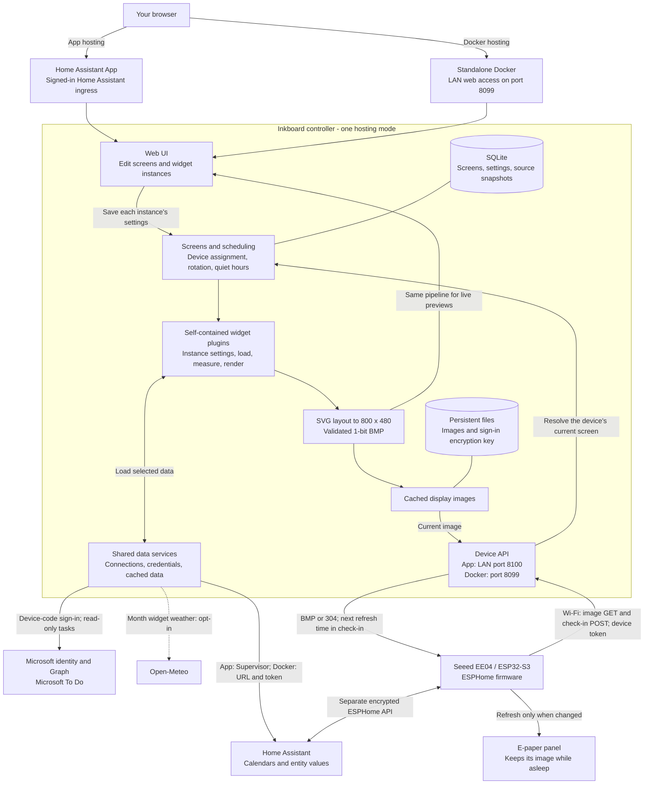

# Inkboard

Local e-paper dashboards for the Seeed Studio **TRMNL 7.5" (OG) DIY Kit**.
Inkboard runs as a Home Assistant App or standalone Docker service that renders
800×480 black-and-white screens, such as your calendar or a Microsoft To Do list.
The display runs a small ESPHome firmware that downloads the current screen and sleeps.

- Calendar agendas and a whole-month calendar from your Home Assistant calendars
- Microsoft To Do lists, read-only, with personal or work accounts
- Japanese vocabulary and beginner grammar, including your own CSV word lists
- Editable screens built from self-contained widgets: headings, text, dates,
  Home Assistant values, agendas, and task lists
- Screen rotation, time-of-day schedules, and quiet hours
- Buttons on the display to switch screens, and battery-friendly deep sleep
- Everything stays on your network; nothing is sent to a cloud service except
  Microsoft identity and Graph when you connect To Do, and Open-Meteo when you turn on the
  month calendar's weather

## Contents

1. [How the app works](#how-the-app-works)
2. [What you need](#what-you-need)
3. [Install the Inkboard App](#1-install-the-inkboard-app)
4. [Assemble the display](#2-assemble-the-display)
5. [Install the firmware](#3-install-the-firmware)
6. [Check that it works](#4-check-that-it-works)
7. [Set up your screens](#5-set-up-your-screens)
8. [Save battery](#6-save-battery)
9. [Update](#update)
10. [Troubleshooting](#troubleshooting)
11. [Privacy and security](#privacy-and-security)

## How the app works

Inkboard has two parts: a **controller on an always-on host** and a **thin
ESPHome client on the display**. Host the same controller either as a Home
Assistant App or as a standalone Docker container. The controller owns data
connections, widget settings, scheduling, and rendering; the display only
downloads images, refreshes its panel, reports status, and sleeps.



| Hosting mode       | Browser access                                                 | Display connection                | Home Assistant data                             |
| ------------------ | -------------------------------------------------------------- | --------------------------------- | ----------------------------------------------- |
| Home Assistant App | Sidebar through authenticated ingress                          | `http://<home-assistant-ip>:8100` | Supervisor-provided access; no long-lived token |
| Standalone Docker  | `http://<host-ip>:8099` on your LAN; no built-in admin sign-in | `http://<host-ip>:8099`           | Home Assistant URL and long-lived token         |

These are default ports. The display must use the host's LAN address, **not**
the Home Assistant ingress URL or `localhost`. Both device endpoints require
the device bearer token. In App mode, the device port exposes only device and
health endpoints, not the admin UI. Standalone port 8099 must stay on a trusted
LAN or behind an appropriately secured proxy.

Each screen stores its own ordered **widget instances**. Two calendar widgets
can select different calendars, and two To Do widgets can select different
lists and display options. Empty selections mean no events or tasks. All
widgets follow the same schema-driven editing and rendering lifecycle;
connections and sign-ins remain shared under **Connections**, and data-source
credentials are never passed to widgets or to the display.

When the display wakes, it requests its current screen; the controller applies
device assignment, rotation, schedules, and quiet hours. A changed image is
downloaded and displayed; an unchanged revision can return `304 Not Modified`
to avoid a redraw. Check-ins report battery, Wi-Fi, buttons, and display status,
and return the next refresh delay. Button presses report their action before
requesting the resulting screen. With maintenance mode off, the device sleeps
between updates: Inkboard does not push images to a sleeping display.

## What you need

- A **Seeed Studio TRMNL 7.5" (OG) DIY Kit**: XIAO ESP32-S3 Plus, EE04 driver
  board, 7.5-inch 800×480 monochrome panel, and battery.
- **Home Assistant OS** or a Supervised installation, which can install Apps.
  On Home Assistant Container or Core, follow
  [Run without the Home Assistant App](docs/standalone.md) instead of step 1.
- The **ESPHome Device Builder** App, version 2026.10.0 or newer.
- A computer with **Chrome or Edge** and a USB-C **data** cable, for the first
  firmware install only.
- A **2.4 GHz** Wi-Fi network. The ESP32-S3 does not support 5 GHz.

## 1. Install the Inkboard App

1. In Home Assistant, go to **Settings → Apps → App store** (called
   **Add-ons → Add-on store** in older versions).
2. Open the **⋮** menu, select **Repositories**, add
   `https://github.com/ramiroidl/inkboard`, and close the dialog.
3. Find **Inkboard** in the store, select **Install**, then **Start**. Turn on
   **Show in sidebar**.
4. Open **Inkboard** from the sidebar and expand **Connections**. **Display setup** shows two
   values you need in step 3:
   - `inkboard_controller_url`, such as `http://homeassistant.local:8100`.
     Replace the host name with your Home Assistant's **IP address**, such as
     `http://192.168.1.50:8100`; the display may not resolve `.local` names.
     You can find the IP under **Settings → System → Network**.
   - `inkboard_device_api_token`, a random token generated for your display.
     Treat it like a password.

Optional settings are on the App's **Configuration** tab, such as the time zone
(empty uses Home Assistant's) and the calendar look-ahead. See the App's
**Documentation** tab for all options.

## 2. Assemble the display

1. Disconnect USB and switch battery power off.
2. Set the EE04 display selector jumper to the **24-pin** position.
3. Insert the display's ribbon (FPC) cable with its metal contacts facing
   **up**, and close the connector latch.
4. Connect the battery, checking its polarity.
5. Connect the XIAO board to your computer with the USB-C data cable.

Never move the jumper or ribbon cable while the board is powered.

## 3. Install the firmware

### 3.1 Install ESPHome Device Builder

In Home Assistant, install the **ESPHome Device Builder** App from the App
store, start it, and open it from the sidebar.

### 3.2 Add the secrets

The firmware reads every private value from ESPHome's secrets file, so none of
them are stored in the device configuration. In ESPHome Device Builder, select
**Secrets** in the top-right corner and add these lines, keeping any that are
already there:

```yaml
wifi_ssid: "Your 2.4 GHz network"
wifi_password: "your-wifi-password"
inkboard_api_encryption_key: "paste-a-generated-key"
inkboard_fallback_password: "at-least-8-characters"
inkboard_controller_url: "http://192.168.1.50:8100"
inkboard_device_api_token: "paste-the-token-from-the-inkboard-page"
```

- `inkboard_api_encryption_key` protects the connection between Home Assistant
  and the display. Copy a freshly generated key from the
  [ESPHome API documentation](https://esphome.io/components/api/#configuration-variables),
  which shows a random key on each visit, or run `openssl rand -base64 32`.
- `inkboard_fallback_password` protects the `Inkboard OG Setup` hotspot the
  display opens if it cannot join your Wi-Fi.
- `inkboard_controller_url` and `inkboard_device_api_token` come from the
  **Display setup** card in step 1. Do not add a trailing slash to the URL.

Select **Save**.

### 3.3 Add the device configuration

1. Select **+ New device**, then **Continue**.
2. Name it `inkboard-og`, choose **ESP32-S3**, and select **Skip** when asked to
   install.
3. On the new card, select **Edit**, replace all of its contents with
   [`firmware/esphome/inkboard-og.yaml`](firmware/esphome/inkboard-og.yaml) from
   this repository, and select **Save**.

### 3.4 Install over USB

The first install must be over USB:

1. On the device card, select **⋮ → Install → Manual download → Factory
   format**, and wait for the compile to finish. The first compile can take
   several minutes.
2. On the computer connected to the display, open
   <https://web.esphome.io/> in Chrome or Edge.
3. Select **Connect**, choose the XIAO's serial port, select **Install**, and
   choose the downloaded `.bin` file.

If no serial port appears, hold **BOOT** on the XIAO, briefly press **RESET**,
release **BOOT**, and try again. Later updates install over Wi-Fi.

### 3.5 Add the display to Home Assistant

After it restarts, Home Assistant discovers the display. Go to **Settings →
Devices & services**, select **Configure** on the discovered **Inkboard OG**,
and enter the same `inkboard_api_encryption_key` when asked. This adds the
display's battery, Wi-Fi, and buttons to Home Assistant, plus the
**Maintenance Mode** switch used in step 6.

## 4. Check that it works

Within a minute of starting, the display refreshes once and shows its current
screen. With no content screens configured, it shows the Inkboard **test
pattern**: a white background, a black square at the top left, and readable
text in the middle. On the Inkboard page, the display appears with its current-screen selector.
Expand **Device details and display settings** for firmware version, battery
voltage, and Wi-Fi signal.

If it does not, see [Troubleshooting](#troubleshooting).

## 5. Set up your screens

Everything below is on the **Inkboard** page in the sidebar. Changes reach the
display on its next refresh or button press.

### Calendars

Add a **Calendar agenda** or **Month calendar** widget to a screen, then tick
the calendars in that widget's settings. Each instance has its own selection;
leaving all unticked shows no events. Up to 10 calendars are merged in time
order, and an event in two calendars is shown once.
Multi-day events show when they end, such as `UNTIL NOV 8`.

If Home Assistant or one calendar is unavailable, the last events stay on the
screen. It recovers on its own. Shared connection setup is under **Connections**.

### Microsoft To Do

Inkboard reads your open tasks from Microsoft Graph with read-only access
(`Tasks.Read`). Signing in uses a code, so no public address or redirect URL is
needed. Microsoft requires an app registration, which is free and done once:

1. Sign in to the [Microsoft Entra admin center](https://entra.microsoft.com)
   with your Microsoft account, open **App registrations**, and select **New
   registration**.
2. Name it `Inkboard`. Under **Supported account types**, choose **Personal
   Microsoft accounts only** for outlook.com or hotmail.com accounts, or
   **Accounts in any organizational directory and personal Microsoft
   accounts** to allow both. Leave the redirect URI empty and select
   **Register**.
3. Open **Authentication**, set **Allow public client flows** to **Yes**, and
   select **Save**. No client secret is needed.
4. Copy the **Application (client) ID** from **Overview**.
5. On the Inkboard page, expand **Connections** and paste it into **Microsoft To Do**, leave the
   tenant as `common`, and select **Save app registration**. Inkboard switches
   the tenant automatically if the app allows only one kind of account.
6. Select **Sign in with Microsoft**, open the link shown, enter the code, and
   approve read access. The card finishes on its own.
7. Add a **To Do list** widget to a screen and tick the lists, such as
   **Tasks** or **Groceries**, in that widget's settings.

Tasks are sorted by due date, then importance, and show `OVERDUE`, `TODAY`, or
the due date, `!` for important tasks, and `↻` for repeating ones. Each
**To Do list** widget owns its list selection and display options. Leaving all
lists unticked shows no tasks, rather than inheriting another selection.

Microsoft sign-in tokens are encrypted before they are saved and never reach
the browser. If Microsoft is unavailable, or the sign-in expires, the last
tasks stay on screen and the card asks you to sign in again. **Sign out**
deletes the tokens and saved tasks.

### Screens and widgets

Select **New screen** and add up to 12 widgets. The preview is rendered by the
controller, so it matches the display pixel for pixel.

| Widget               | Shows                                                                               |
| -------------------- | ----------------------------------------------------------------------------------- |
| Heading              | Bold title, large, medium, or small                                                 |
| Text                 | Wrapped message, up to six lines                                                    |
| Date & time          | Date (default), clock, or both; a clock can lag between refreshes                   |
| Home Assistant value | Any entity's state and unit, such as `sensor.outdoor_temp`; three can share a row   |
| Calendar agenda      | Next events from calendars chosen for this widget                                   |
| Month calendar       | The whole month with event names, today marked, past days crossed out, and weather  |
| To Do list           | Open tasks from chosen To Do lists, with optional due dates and list names          |
| Japanese Study       | Vocabulary with kana readings and translations, plus short beginner grammar lessons |
| Divider              | Heavy horizontal rule                                                               |

For example, a grocery screen is a **Heading** that says "Groceries" and a
**To Do list** widget with only **Groceries** ticked and due dates hidden. Lists
that do not fit end with `+N MORE`.

For a wall calendar, make a screen with only the **Month calendar** widget: on
its own it fills the whole display, without margins or the screen name. Each
day shows as many event names as fit, then `+n`. Today has a black bar, past
days are crossed out (optional), and the week can start on Monday or Sunday.
The month name can sit before the weekday names (`Nov`), run down the left
side in full (`NOVEMBER`), or be hidden to give the days more room, and the
text comes in normal, large, and extra large. Larger text fits fewer events per
day. Under a **Heading**, choose a smaller heading size to leave more room for
the calendar.
Tick **Show weather** for a seven-day forecast in the corner of each day. The
forecast comes from [Open-Meteo](https://open-meteo.com/) (CC BY 4.0) for Home
Assistant's home location, rounded to about 1 km, and refreshes hourly; it is
off by default because it sends that location to Open-Meteo.

#### Learn Japanese

Add **Japanese Study** as the only widget on a screen for a full 800×480 lesson.
Choose **Vocabulary and grammar**, **Vocabulary only**, or **Grammar only**.
The bundled collections contain 36 curated N5 starter words and 24 travel
essentials; they are not official or exhaustive JLPT lists. Advanced N4–N1
bundled courses are not included yet, but you can import your own vocabulary.

Words show their Japanese spelling, kana reading, and translation. Select one
to three words per screen; **Show romaji when provided** is off by default.
Grammar starts with polite **ます**, including its non-past use for habits and
future actions. **Starting out** shows introductory lessons; **N5 / beginner
review** also includes verb stems, irregular verbs, and additional particles.
Choose a focused topic or follow the beginner course.

Vocabulary changes daily or hourly, and grammar daily or weekly, from the
**Course start date** in the controller's time zone. A new widget starts on
today's date. Refreshing or opening its preview does not skip ahead. Lessons
cycle after the collection ends; this is passive study, not recall tracking or
spaced repetition. The device's existing buttons still navigate screens.

To use your own list, upload **CSV UTF-8** with these column names:

```csv
word,reading,translation,level,romaji
食べる,たべる,to eat,N5,taberu
駅,えき,station,N5,eki
```

`word`, `reading`, and `translation` are required. Optional columns are
`level` (`N5`–`N1`, informational), `romaji`, `example`, `example_reading`,
`example_translation`, and `tags`. Quoted commas, escaped quotes, and multiline
cells are supported. Example sentences appear in vocabulary-only mode; choose
one word per screen to leave them more room.

Files must be UTF-8, comma-separated, at most 128 KiB, and contain at most 200
words. Review the import preview, select **Import**, then choose **Uploaded CSV**
or **Bundled and uploaded words** as the vocabulary source and save the screen.
Invalid rows are reported without replacing the current list. Imported words
belong to this widget instance and are included in screen backups. No external
learning service, account, or firmware update is needed.

All content screens use the same editable widgets. On upgrade, existing
Calendar and To Do screens become regular screens automatically, and widgets
that inherited page-wide selections get those selections saved into their
own settings. Rotation, schedules, and device assignments are preserved.
Deleting one of these screens does not recreate it. The test pattern is a
diagnostic fallback, not a content widget.

Expand **Display diagnostics** below the screen list and untick **Show the
test pattern screen** to hide it once you have other screens. Device details,
connections, rotation, schedules, quiet hours, and backup controls are collapsed
by default; screen design and each device's current-screen selector stay visible.

### Rotation, schedules, and quiet hours

- **Automatic rotation**: add screens in order and choose an interval (5–1,440
  minutes), for example **Calendar** and **To Do** every 15 minutes.
- **Schedules**: show a screen on chosen days between two times, such as the
  agenda on weekday mornings. Schedules take priority over rotation.
- **Quiet hours**: a nightly window when the display keeps its image and, with
  maintenance mode off, sleeps straight through.

The display's buttons:

- **KEY1** shows the previous screen and **KEY3** the next one. A manual choice
  stays for one rotation interval.
- **KEY2** refreshes the current screen.

### Back up or move your screens

Expand **Backup and restore**. **Export** downloads your screens (including
each widget's settings), rotation, schedules, and quiet hours as a file.
**Import** applies such a file, for example on a new Home Assistant. Screens
that already exist are kept rather than duplicated. Sign-ins and tokens are not
included, so connect the data sources to show live data after importing.
Older backups are accepted and their inherited selections are saved into
individual widgets.

## 6. Save battery

While **Inkboard OG Maintenance Mode** is on (the default), the display stays
awake so it can receive firmware updates, and checks for a new image every 15
minutes. Once everything works, turn it **off** in Home Assistant: the display
then sleeps between refreshes, waking when its next screen change is due (at
most every 15 minutes, longer during quiet hours) or when you press a key.

## Update

- **Inkboard App**: Home Assistant shows an update under **Settings →
  Updates** when a new version is published. Your screens and settings are
  kept.
- **Firmware**: replace the device configuration with the new
  `inkboard-og.yaml` and select **Install → Wirelessly** in ESPHome Device
  Builder. If maintenance mode is off, turn it on first, or press a key to wake
  the display, so it is awake for the update.

The App and firmware have separate version numbers. The firmware only changes
when the display itself needs new behavior.

## Troubleshooting

**No serial port in web.esphome.io.** Use a data cable, not a charge-only
cable. Hold **BOOT**, press **RESET**, then release **BOOT**.

**The display never refreshes or is missing from the Inkboard page.** Open the
device's **Logs** in ESPHome Device Builder. Check that your Wi-Fi is 2.4 GHz
and that `inkboard_controller_url` uses the IP address and port **8100**.

- HTTP `401`: `inkboard_device_api_token` does not match the **Display setup**
  settings under **Connections**. Copy it again and reinstall the firmware.
- Connection errors: the Inkboard App is not running, the port under the App's
  **Network** section is not 8100, or a firewall blocks it.

**Reversed colors (black background).** Turn maintenance mode on and press
**Inkboard OG Force Redraw** in Home Assistant once. If the colors are still
reversed, expand **Device details and display settings** on the display's card
and tick **Invert colors**;
the display picks it up on its next refresh, without reinstalling the firmware.

**A wireless firmware update fails.** Turn maintenance mode on, or press a key
and start the install while the display is awake. As a last resort, reinstall
over USB.

**The Inkboard App fails to install.** Home Assistant could not download the
image. See the App's **Documentation** tab.

**To Do says the app "does not allow device sign-in".** Set **Allow public
client flows** to **Yes** in the app registration.

**A calendar or To Do list shows no data.** Edit the screen and check that this
widget has calendars or lists ticked; it does not inherit another widget's
selection. Expand **Connections** to check the source connection or Microsoft
sign-in.

**A calendar or To Do list shows old data.** Check **Connections** for Microsoft
sign-in errors and the controller log for source refresh failures. Sources keep
their last good data during outages; widgets without cached data show an error
in the preview and on screen.

## Privacy and security

- The Inkboard page is only reachable through Home Assistant, so only your
  signed-in Home Assistant users can open it. Port 8100 serves only device and
  health endpoints; device requests need the device token.
- Home Assistant data is read through the Supervisor; no long-lived access token
  is created.
- Your Wi-Fi password and keys live in ESPHome's secrets file, not in the
  device configuration or this repository.
- The month calendar's weather, when turned on, sends Home Assistant's home
  location, rounded to about 1 km, to Open-Meteo once an hour. No account or
  key is involved.
- Microsoft To Do access is read-only. Tokens are encrypted with AES-256-GCM in
  the App's data folder and never sent to the browser.
- Screens, settings, and saved data are stored in the App's data folder and
  included in Home Assistant backups.

If you fork this repository, keep `secrets.yaml` and `.env` out of Git; both
are already listed in `.gitignore`.

## More documentation

- [Firmware details](firmware/esphome/README.md): sensors, buttons, sleep, and
  recovery
- [Run without the Home Assistant App](docs/standalone.md): Docker on any
  computer
- [Develop Inkboard](docs/development.md): build, test, and release
- [Write widgets](docs/widgets.md)
- [Product specification](docs/product-spec.md),
  [system design](docs/system-design.md), and
  [implementation plan](docs/implementation-plan.md)

## License

Inkboard is released under the [MIT License](LICENSE).
