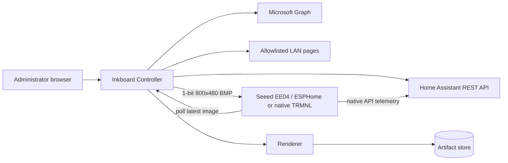
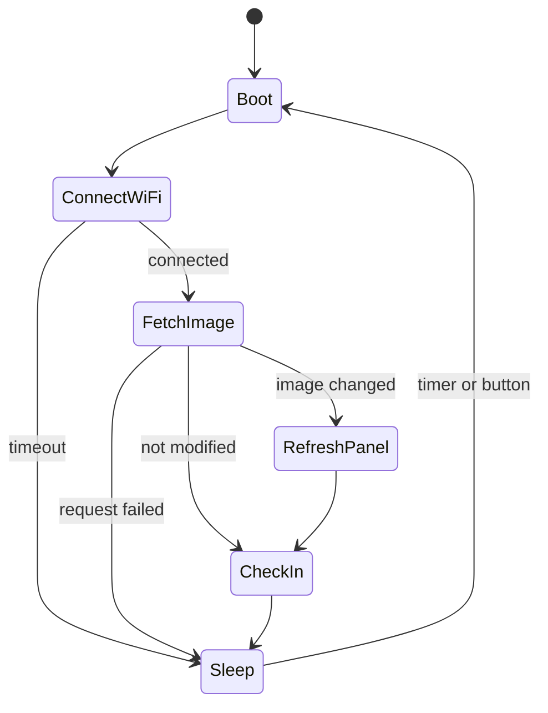

# Inkboard Controller system design

## 1. Design decision

Use a **thin display client and local rendering controller**, delivered first as
a Home Assistant App and also runnable as a normal Docker service.

ESPHome is the primary device client because Seeed publishes a working
configuration for this exact EE04 kit and it exposes all three programmable
buttons. It owns hardware, Wi-Fi, image download, display refresh, button wake,
telemetry, OTA, and deep sleep. Native TRMNL firmware remains a later compatible
client. The controller is responsible for integrations, credentials, browser
capture, widget layout, rendering, caching, and scheduling.

This boundary is preferred over rendering widgets directly in ESPHome because:

- Microsoft OAuth and refresh-token handling do not belong on a microcontroller;
- full calendar and task collections are awkward to model as ESPHome entities;
- arbitrary pages require a browser engine before they can be shown on e-paper;
- server-side rendering gives a faithful preview and a single layout system;
- a 1-bit image keeps firmware behavior stable as widgets evolve; and
- the e-paper image survives sleep and controller outages.

## 2. Context



The device always initiates network traffic. The controller does not depend on
being able to open a connection to a sleeping ESP32.

## 3. Hardware baseline

The test device is the Seeed Studio TRMNL 7.5-inch (OG) DIY Kit built around the
XIAO ePaper Display Board EE04 and XIAO ESP32-S3 Plus. These documented values
must be verified on the physical kit before firmware work proceeds.

| Function           | Value                                                    |
| ------------------ | -------------------------------------------------------- |
| Board              | Seeed XIAO ePaper Display Board EE04                     |
| MCU                | XIAO ESP32-S3 Plus, dual-core up to 240 MHz              |
| Memory             | 16 MB flash, 8 MB octal PSRAM                            |
| Display            | 7.5-inch monochrome, 800x480                             |
| Framebuffer        | 48,000 bytes at 1 bit per pixel                          |
| Display driver     | UC8179, ESPHome `7.50inv2`                               |
| SPI clock          | GPIO7                                                    |
| SPI MOSI           | GPIO9                                                    |
| Display CS         | GPIO44                                                   |
| Display DC         | GPIO10                                                   |
| Display reset      | GPIO38                                                   |
| Display busy       | GPIO4, active-low/inverted                               |
| Display enable     | GPIO43                                                   |
| KEY1               | GPIO2, active-low                                        |
| KEY2               | GPIO3, active-low                                        |
| KEY3               | GPIO5, active-low                                        |
| Battery ADC        | GPIO1 through a 2:1 divider                              |
| Battery ADC enable | GPIO6, active-high                                       |
| Battery            | 2000 mAh rechargeable Li-ion                             |
| Other controls     | Reset, XIAO Boot, battery power switch, 24/50-pin jumper |

The EE04 must be jumpered for the 24-pin display before power-up. Seeed's
published ESPHome configuration uses the Arduino framework, octal PSRAM at
80 MHz, `waveshare_epaper` model `7.50inv2`, and the pins above. The legacy
`waveshare_epaper` component is scheduled for removal in ESPHome 2027.5, so pin
the initial known-good ESPHome release and plan migration to `epaper_spi`.

The board has three programmable active-low user keys plus Reset. Under upstream
TRMNL firmware only KEY3 is used: single-click refresh, configurable
double-click, and approximately five-second hold for Wi-Fi reconfiguration.
ESPHome can use all three keys, so Inkboard defaults them to previous, refresh,
and next. Multi-key wake, debounce, click/double-click/hold behavior, and safe
OTA recovery must be proven during the hardware spike.

## 4. Logical components

### 4.1 Controller API

Responsibilities:

- authentication and administration;
- device registration and image authorization;
- CRUD for screens, layouts, widgets, connectors, and schedules;
- latest-image and device check-in endpoints;
- health and diagnostics.

Implementation: a TypeScript service with a versioned REST API and React
administration UI. Package the same application as a Home Assistant App and a
normal Docker image. Keep internal interfaces renderer-agnostic so the service
can be split only if load or packaging requires it.

### 4.2 Scheduler

The scheduler determines the active screen and queues a render when:

- a schedule boundary is crossed;
- cached connector data changes;
- screen configuration changes;
- an administrator requests a refresh; or
- the current artifact is missing.

Jobs are idempotent by a content key derived from screen configuration, source
revisions, dimensions, renderer version, and dithering settings.

### 4.3 Connectors

Connectors convert upstream data into normalized internal models.

**Home Assistant**

- REST client with base URL and long-lived token.
- Calendar event fetch by explicit start/end window.
- Entity state fetch by explicit entity ID.
- Short cache and bounded retries for transient failures.

**Microsoft To Do**

- Microsoft identity platform delegated OAuth.
- Initial least-privilege scope: read-only tasks plus required identity/offline
  access scopes.
- Graph endpoints for list discovery and task retrieval.
- Refresh-token rotation and reauthorization state.

Connector interfaces return data, source revision, fetched time, stale time, and
an explicit error classification. They do not return presentation markup.

### 4.4 Page capture

A sandboxed headless Chromium worker loads explicitly allowlisted URLs with:

- an 800x480 viewport;
- fixed locale and time zone;
- configurable network-idle and post-load timeout;
- optional selector capture;
- blocked downloads, popups, microphone, camera, and geolocation; and
- redirect and hostname validation on every request.

The worker returns pixels only. Browser storage is isolated per configured
source and capped.

### 4.5 Widget renderer

Widgets render to deterministic HTML/CSS or SVG using a shared design system.
The renderer captures the result at 800x480, converts it to monochrome, validates
it, and writes an immutable artifact.

Rendering stages:

1. resolve screen and normalized connector data;
2. lay out widgets on the 8-pixel grid;
3. render an 800x480 grayscale surface;
4. apply contrast normalization and threshold/dithering;
5. encode as 1-bit BMP;
6. verify dimensions, bit depth, payload size, and checksum;
7. atomically promote the artifact to `latest`.

Recommended visual constraints:

- white background and black foreground by default;
- minimum body text of approximately 18 px;
- avoid hairlines below 2 px;
- no information encoded by gray or color alone;
- truncate explicitly rather than overflow;
- reserve a small footer region for freshness only when configured.

### 4.6 Artifact store

The first release uses the local filesystem for image bytes and SQLite for
metadata. A transaction promotes an artifact only after file validation.

Retain:

- the current successful artifact;
- the immediately previous artifact; and
- bounded diagnostic artifacts for failed previews, never for device delivery.

## 5. Device protocol

The primary contract is the small direct image API for ESPHome. A separate
adapter exposes a compatible subset of the TRMNL BYOS protocol for native
firmware: `/api/setup`, `/api/display`, `/api/log`, and immutable image delivery.

### Direct latest image

```http
GET /api/v1/devices/{deviceId}/image
Authorization: Bearer <device-image-token>
If-None-Match: "<known-revision>"
```

Responses:

- `200 image/bmp` with `ETag`, `Last-Modified`, `X-Screen-Revision`, and
  `X-Refresh-After`;
- `304 Not Modified` when the revision is unchanged;
- `401/403` for invalid or revoked credentials; and
- `503` only when no successful artifact has ever been produced.

The endpoint never redirects. This keeps token handling and the ESPHome HTTP
client simple.

### Check-in

```http
POST /api/v1/devices/{deviceId}/check-ins
Authorization: Bearer <device-image-token>
Content-Type: application/json

{
  "firmwareVersion": "0.1.0",
  "screenRevision": "sha256:...",
  "batteryVoltage": 3.91,
  "wifiRssi": -61,
  "wakeReason": "timer",
  "displayResult": "success"
}
```

Check-in failure must never prevent displaying an already downloaded image.

## 6. ESPHome lifecycle



Implementation rules:

- Set display and image `update_interval` to `never`; orchestrate explicitly.
- Configure online image as `BMP` and `BINARY`, not `AUTO`.
- Enable and verify octal PSRAM. Reduce the HTTP/image download buffer from its
  64 KB default only after measuring a stable minimum.
- Refresh only after a successful, validated download of a changed revision.
- Release the online image buffer before deep sleep when supported.
- Cap the awake period so network failure cannot drain the battery.
- Keep deep sleep disabled during commissioning and provide a maintenance switch
  for OTA.
- Configure KEY1 GPIO2, KEY2 GPIO3, and KEY3 GPIO5 as active-low inputs with
  debounce. Test multi-pin deep-sleep wake before enabling it by default.
- Enable GPIO6 only while sampling battery voltage on GPIO1, then disable it.
- Verify whether GPIO43 must remain enabled through panel refresh and when it is
  safe to power down the display circuit.

## 7. Data model

| Entity          | Important fields                                                                   |
| --------------- | ---------------------------------------------------------------------------------- |
| Device          | id, name, token hash, width, height, orientation, interval, quiet hours, last seen |
| Screen          | id, name, source type, source config, render settings, revision                    |
| Widget          | id, screen id, kind, grid rectangle, connector binding, options                    |
| Schedule        | id, device id, screen id, weekdays, start/end, priority                            |
| Connector       | id, kind, public config, encrypted secret, status, last sync                       |
| Source snapshot | connector id, normalized payload, source revision, fetched/stale times             |
| Artifact        | id, screen id, content key, checksum, path, created time, render metadata          |
| Check-in        | device id, time, firmware, artifact revision, battery, RSSI, result                |

Store token hashes rather than recoverable device tokens. Encrypt connector
secrets with a deployment key provided outside the database.

## 8. Security design

- Bind to the LAN by default and require administrator authentication.
- Use separate credentials for administration and image retrieval.
- Scope device tokens to one device and read/check-in operations only.
- Never log authorization headers, cookies, OAuth codes, or source page content.
- Encrypt Home Assistant and Microsoft credentials at rest.
- Apply CSRF protection and secure cookie settings to the admin UI.
- Validate local-page DNS results and every redirect against the source
  allowlist; block metadata endpoints and unintended networks.
- Limit response size, render duration, browser memory, and connector retries.
- Prefer HTTPS with a trusted local CA; if plain HTTP is selected for a trusted
  LAN, treat the device image token as observable and make rotation easy.
- Pin container images and dependencies, and run Chromium without access to the
  Docker socket or host filesystem.

## 9. Caching and freshness

| Data                    | Typical refresh       | Stale fallback              |
| ----------------------- | --------------------- | --------------------------- |
| Home Assistant calendar | 5 minutes             | 6 hours                     |
| Home Assistant entity   | 1-5 minutes           | 1 hour                      |
| Microsoft To Do         | 5-15 minutes          | 24 hours                    |
| Local page capture      | screen schedule       | previous successful capture |
| Rendered artifact       | on content-key change | indefinitely until replaced |

The display polling interval and connector refresh interval are independent.
This prevents every device wake from causing Microsoft or Home Assistant API
traffic.

## 10. Observability

Expose:

- `/health/live` for process health;
- `/health/ready` for database and artifact-store readiness;
- per-connector sync status and last error;
- render queue depth, duration, success/failure, and artifact size;
- device last seen, battery trend, RSSI, and last displayed revision; and
- structured logs with correlation IDs.

Do not make upstream connector availability a readiness requirement; cached
screens must remain serviceable during upstream outages.

## 11. Repository shape

```text
controller/
  src/
    api/
    connectors/
    renderer/
    scheduler/
    storage/
    widgets/
  migrations/
  tests/
firmware/
  packages/
  inkboard-og.yaml
  secrets.example.yaml
docs/
```

Widget contracts and normalized connector models belong in the controller, not
in ESPHome YAML.

## 12. Verification strategy

### Hardware gate

- solid white, solid black, border, checkerboard, text, and orientation patterns;
- repeated cold boot, timed wake, and GPIO wake;
- busy timeout and panel sleep behavior;
- USB and battery operation;
- heap measurements during BMP download, decode, refresh, and release.

### Controller

- golden-image tests for every widget and dithering preset;
- contract tests against recorded Home Assistant and Graph responses;
- redirect/allowlist tests for page capture;
- scheduler tests across time zones and daylight-saving transitions;
- artifact atomicity and last-good fallback tests; and
- API authorization and token-revocation tests.

### End to end

- controller publishes a known revision;
- device obtains and displays it;
- unchanged revision avoids refresh;
- controller and upstream outages retain the panel image;
- reconnection advances to the newest valid revision.

## 13. Risks and mitigations

| Risk                                                    | Mitigation                                                                                   |
| ------------------------------------------------------- | -------------------------------------------------------------------------------------------- |
| Physical panel differs from Seeed's documented revision | Reproduce the official `7.50inv2` example before adding network behavior                     |
| ESP32-S3 image memory or PSRAM configuration errors     | Require octal PSRAM, use 1-bit BMP/BINARY, explicit release, and measured heap thresholds    |
| E-paper ghosting or temperature-dependent output        | Start with full refresh and preserve selectable temperature profiles in a custom driver      |
| ESPHome display component migration                     | Isolate display YAML and pin the known-good ESPHome version                                  |
| Accidental factory reset from a button hold             | Reserve destructive actions for explicit multi-step gestures and provide UI confirmation     |
| Three-button wake increases sleep current               | Measure each wake configuration and allow button wake to be disabled per device              |
| Microsoft OAuth complexity                              | Keep it server-side, use delegated least privilege, and ship after the local vertical slice  |
| Unsafe local-page capture                               | Explicit allowlist, redirect validation, isolated Chromium, resource limits                  |
| Battery drain during failures                           | Bound awake time, back off retries, use quiet hours, and sleep after retaining the old image |

## 14. Source notes

Design assumptions were checked against:

- [TRMNL firmware](https://github.com/usetrmnl/trmnl-firmware) for native
  protocol and Seeed device support;
- [Seeed TRMNL DIY Kit documentation](https://wiki.seeedstudio.com/trmnl_7inch5_diy_kit_main_page/)
  for the exact board, display, battery, controls, and supported firmware;
- [Seeed ESPHome cookbook](https://wiki.seeedstudio.com/ogdiy_kit_works_with_esphome/)
  for the verified display, PSRAM, button, and battery pin map;
- [TRMNL BYOS documentation](https://docs.trmnl.com/go/diy/byos) for image size,
  format, caching, and polling behavior;
- [ESPHome online image](https://esphome.io/components/image/online_image/) for
  runtime BMP/BINARY download and memory constraints;
- [ESPHome e-paper display documentation](https://esphome.io/components/display/waveshare_epaper/)
  for display update behavior;
- [Home Assistant REST API](https://developers.home-assistant.io/docs/api/rest/)
  for calendar and entity access; and
- [Microsoft Graph To Do overview](https://learn.microsoft.com/en-us/graph/api/resources/todo-overview)
  for list/task resources and endpoints.
